# DataReliability: SaaS SRE & Disaster Recovery Lab

A small customer-records API (FastAPI + PostgreSQL on Kubernetes) used as a test subject for
reliability engineering: **SLOs with burn-rate alerting, five injected production failures,
two measured disaster-recovery drills, and blameless post-incident reviews written from recorded
evidence.** Built locally on kind, then deployed to AWS (EKS, RDS, S3) with Terraform for an RDS
point-in-time-restore drill, and torn down afterwards.

> **Scope, stated plainly.** This is a personal lab, not production experience. The application is a
> stand-in for an enterprise data-management SaaS. The architecture is simplified, and it is **not** a
> model of any company's internal platform. The SLO targets are lab targets. Every number below was
> measured on 2026-10-19 (scenarios and DR 001 on a local kind cluster, DR 002 on AWS) and links to
> its raw evidence file.

## Results at a glance

| # | Failure injected | Detected by | TTD¹ | Impact | Budget² | What it taught |
|---|---|---|---|---|---|---|
| [01](docs/incidents/2026-10-19-scenario-01-oomkilled-after-rollout.md) | Memory limit cut to 48 Mi | `APIPodRestarting` | 86 s | 4 min outage | 2.0% | **Hypothesis wrong.** The rollout *succeeded*; pods died 5 min later under load, after the old ones were gone |
| [02](docs/incidents/2026-10-19-scenario-02-index-drop.md) | Index dropped on 1M-row table | run 1: **nothing**; run 2: `APIRouteLatencyDegraded` | — / 6 min 15 s | search p95 10 → 628 ms | 0% | The aggregate latency SLO hid a **63× regression** on one route; per-route alert added, re-run detected it |
| [03](docs/incidents/2026-10-19-scenario-03-credential-drift.md) | DB password rotated, Secret not | `APIAvailabilityFastBurn` | 60 s | 3 min full outage | 2.1% | Latent for 60 s, broke at the next DB restart; **backups silently failed too** |
| [04](docs/incidents/2026-10-19-scenario-04-bad-release.md) | Release with SQL/schema mismatch | `APIAvailabilityFastBurn` | 39 s | ~3 min, creates only | 1.5% | Readiness ≠ correctness. Found and **fixed** misleading error classification and dropped requests on rollout; re-ran to verify |
| [05](docs/incidents/2026-10-19-scenario-05-node-failure.md) | Worker node killed | none needed (self-healed) | — | ~50 s of partial errors | ≤ 0.02% | One replica for **5 min → 30 s** after tuning eviction; impact depends on the client's connection model; **no rebalancing after recovery** |
| [DR](docs/dr/dr-drill-001-results.md) | DB StatefulSet **and volume** deleted | `APIAvailabilityFastBurn` | 45 s | 81 s | 0.5% | **RTO 92 s / RPO 216 s, both met, RPO by timing not design.** Found **0-byte "backups"** left by failed jobs |
| [DR 002 · AWS](docs/dr/dr-drill-002-rds-pitr-results.md) | `DELETE` of 166,721 customers on healthy **RDS** | **nothing**: availability stayed 100% | — | wrong data for 15 min | — | **RDS PITR: recovered in 15 min 52 s, 100% of pre-incident data**; 2,372 later inserts reconciled, 101 updates lost; backups shrank 17% and nobody noticed |

¹ Time from impact to first page/alert. ² Share of the 30-day availability error budget (99.9% at the nominal 10 rps = 25,920 failed requests), from Prometheus counters.

### The whole afternoon on one dashboard

Every local scenario ran against the same cluster between 19:05 and 20:40 UTC. This is the project's
Grafana dashboard over that window. Each spike is one injected failure:

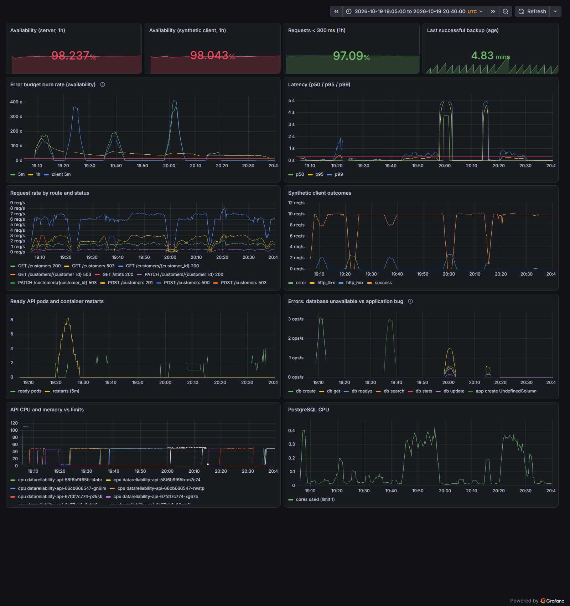

How to read it:
- **Error budget burn rate** (top left). Each peak is an incident; the red line is the 14.4× fast-burn
  paging threshold. The highest peaks (about 370× and 410×, around 19:20 and 20:00) are the
  **full outages**: scenario 01, where pods were OOM-killed, and scenario 03, credential drift. The smaller
  peaks (about 170× and 190×) are scenario 04's bad release, which broke creates only, run twice
  (19:08, 19:35).
- **Latency** (top right). The 5-second plateaus around 20:00 and 20:15 are requests waiting out the
  database pool timeout during scenario 03 and DR Drill 001. That's the "fails slowly" finding.
- **Ready API pods and restarts** (middle left). Scenario 01's crash loop shows as 8 restarts with ready
  pods at 0 around 19:22.
- **Synthetic client outcomes** (middle right). The client-side view: `success` drops to zero during the
  full outages, even while the server exports no errors of its own.
- **Errors: database unavailable vs application bug** (bottom right of the middle row). The split was added
  *because of* scenario 04, when a SQL bug was being reported as a database outage.
- The stat panels at the top show the 1-hour SLIs at the end of the window. They're red because this
  was a deliberately abusive afternoon, not a normal day.

### Scenario 02 close-up: a regression the aggregate SLO could not see

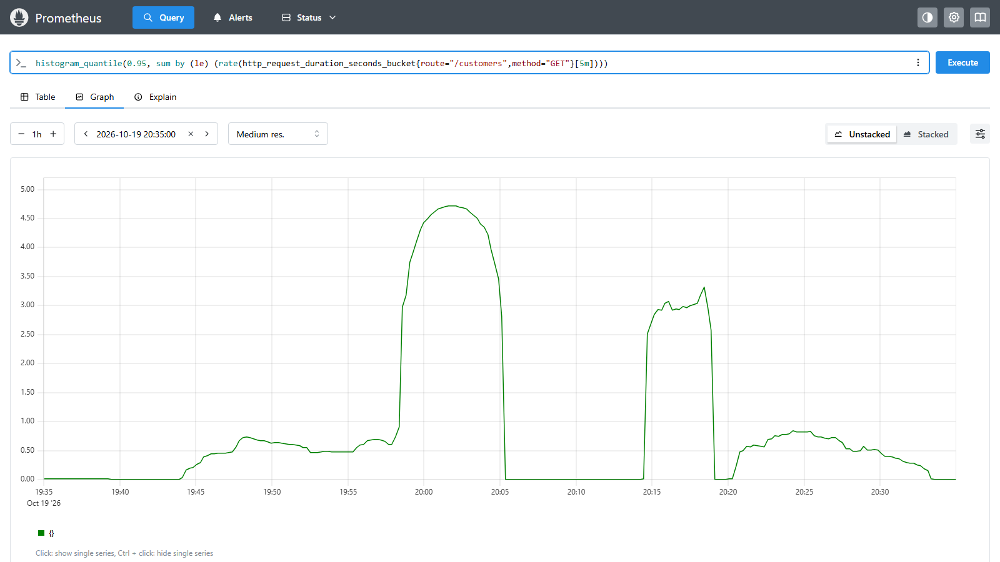

p95 latency of **search only** (`GET /customers`). Normal is about 10 ms, flat on the floor.
- **19:44–19:56, run 1:** the dropped index pushes search to 0.45–0.7 s. **No alert fired**, because
  search is 15% of traffic and only about 2.6% of all requests crossed 300 ms, inside the 5% latency
  budget.
- **19:58–20:05 and 20:14–20:19:** the tall plateaus are *other* incidents, scenario 03 and DR Drill
  001, where every request waited on an unreachable database. They aren't index problems.
- **20:20–20:33, run 2:** the same regression, now with the per-route alert `APIRouteLatencyDegraded`,
  which fired 6 min 15 s in. It recovers on the right once the index is rebuilt with
  `CREATE INDEX CONCURRENTLY`.

### Bugs this lab found in its own design (and fixed)

| Found by | Problem | Fix |
|---|---|---|
| Scenario 04 | SQL bugs reported as `503 database error` → wrong alert, misleading retry signal | Classify `OperationalError` → 503 vs everything else → 500 + `app_errors_total` |
| Scenario 04 | Rollouts dropped in-flight requests | `preStop` sleep; verified 0 timeouts on re-run |
| Scenario 02 | One route degraded 63× with no alert | Per-route p95 recording rule + `APIRouteLatencyDegraded` |
| Scenario 03 | Backup-stale alert threshold was 3× the RPO target | 15 min → 7 min, page |
| Scenario 03 | `PostgresBackupJobFailed` kept firing an hour after recovery | Count only jobs started in the last 15 min |
| Scenario 03 + DR | Failed `pg_dump \| aws s3 cp -` uploaded **0-byte `.dump` files**; restore picks "newest" | Dump → validate with `pg_restore -l` → upload; restore skips invalid archives; `verify-backup` command |
| Scenario 05 | Error counters that appear on first error are invisible to `increase()`/`rate()` | Pre-initialise label sets to 0; re-run counted correctly |
| Scenario 05 | Default 300 s eviction left one replica serving for ~5 min after a node died | `nodeFailureTolerationSeconds: 30`; re-run measured ~30 s |
| Scenario 05 follow-up | `rollout restart` stacked both replicas on one node (terminating pods skew spreading) | `matchLabelKeys: [pod-template-hash]`; verified over 3 rollouts |
| Scenario 01 | Evidence recorder missed alerts that re-fired | Transition-based alert tracking; baseline waits for pages to clear |
| First CI run on GitHub | Trivy blocked the backup image: CRITICAL CVE in `gosu` inherited from the `postgres` base image | Removed the unused binary (not suppressed); backup image 1.0.2 |

## Disaster-recovery drills

### DR Drill 001 (local): database and its volume destroyed, restored from off-cluster backups

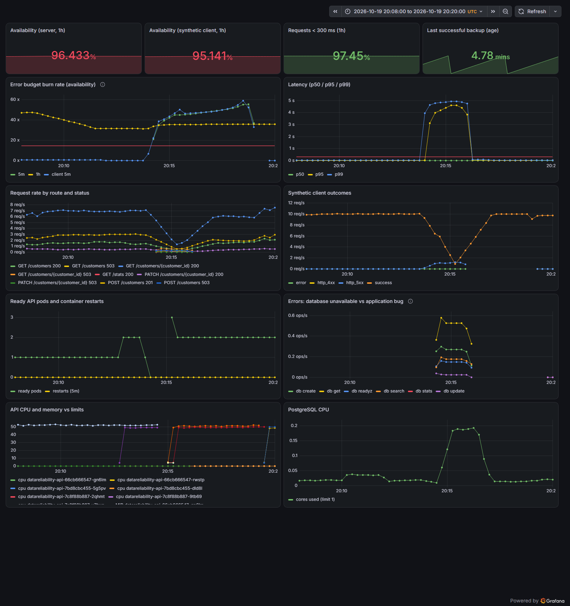

The disaster struck at 20:13:36. Look at:
- **Synthetic client outcomes:** `success` falls to zero and recovers about 90 s later.
- **Ready API pods:** these go to 0 on purpose. Runbook step 1 is *stop writes* (scale the API to 0)
  so nothing writes to the empty replacement database. Then the restore runs, and the pods return.
- **PostgreSQL CPU:** the bump is `pg_restore` loading 1M rows and rebuilding indexes, in 12 s.

The 5-minute rate windows make panels trail the event by a few minutes. The precise timeline comes
from the outside-in probe. Result: **RTO 92 s, RPO 216 s**, with the caveats in the
[full write-up](docs/dr/dr-drill-001-results.md).

### DR Drill 002 (AWS): accidental `DELETE`, recovered with RDS point-in-time restore


PITR never rewinds a database in place. It builds a **new** instance from the backups and transaction
logs as of a chosen second. Here, `…-pitr-220855` was restored to 1 s before the `DELETE` committed
and became the new primary. The original `datareliability-lab-postgres` was kept unmodified for
investigation. Building the new instance took 12 min 15 s of the 15 min 52 s recovery.


The logical backups noticed what no alert did. The first dump after the `DELETE` is **16.7% smaller**
(31.3 → 26.1 MiB), the next two stay small, and size returns after the cutover to the restored
instance. A "backup shrank > 10%" alert would have caught the data loss within about 3.5 minutes.
These three dumps are also valid archives full of *wrong* data, which is why "restore the newest
backup" is the wrong reflex for logical corruption.

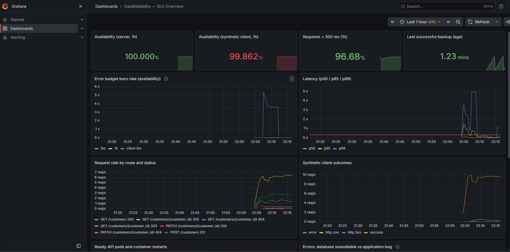

The same dashboard running on EKS during the drill. **Server-side availability: 100%** while a sixth
of the customers were missing. Reads of deleted customers return `404`, which is correctly not an
availability error. SLOs measure whether the service answers, not whether the data is right. The
synthetic client's 99.86% is mostly the planned 13-second write freeze during cutover.
[Full write-up](docs/dr/dr-drill-002-rds-pitr-results.md).

## Architecture

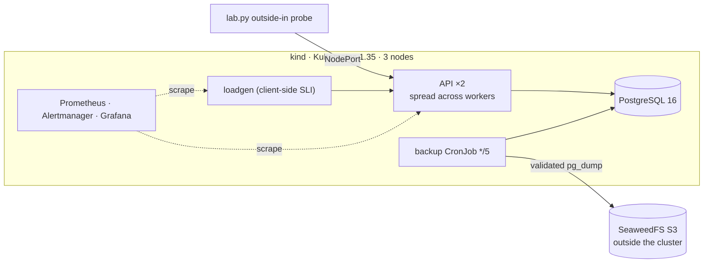

Full design, placement decisions, health model and the AWS mapping: [docs/architecture.md](docs/architecture.md).

| Layer | Local (Milestone 1, $0) | AWS (Milestone 2, [deployed and drilled](docs/aws-deployment.md)) |
|---|---|---|
| Kubernetes | kind 1.35, 1 control plane + 2 workers | EKS 1.35, managed node group (Spot, 2 AZs), IMDSv2 hop 1 |
| Database | PostgreSQL 16 StatefulSet | RDS PostgreSQL 16, encrypted, PITR, Secrets Manager password |
| Backups | `pg_dump` → SeaweedFS (S3 API) | `pg_dump` → S3 (same script) + RDS automated backups |
| Delivery | Helm chart | Helm + ECR (immutable tags, scan on push) |
| Observability | kube-prometheus-stack, SLO rules chart, Grafana dashboard | same, plus CloudWatch control-plane logs |
| Guardrails | — | AWS Budget (optional; account already had a $20 cap), GuardDuty (opt-in) |
| Identity | static keys for the local S3 store | EKS Pod Identity; backup role **verified unable to delete** backups |

### On AWS

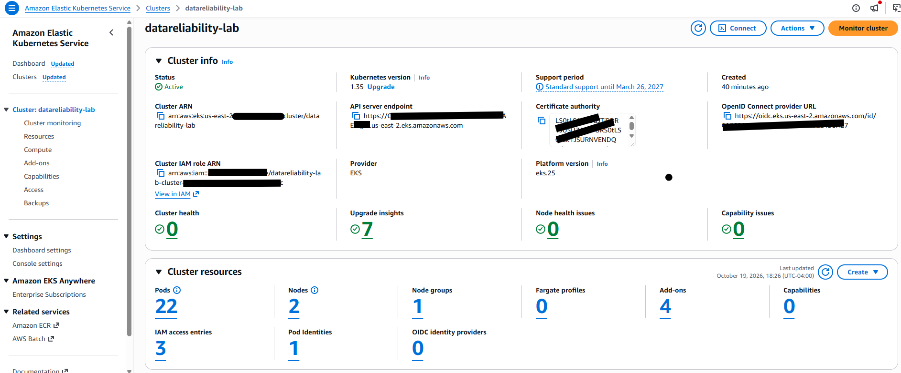

The EKS cluster built by `terraform apply`: Kubernetes **1.35**, matching the local kind cluster and
inside the 1.32–1.35 range Semarchy documents for self-hosted deployments. 22 pods: the API, load
generator, monitoring stack and EKS system add-ons. **1 Pod Identity** association: the backup job's
keyless S3 access.

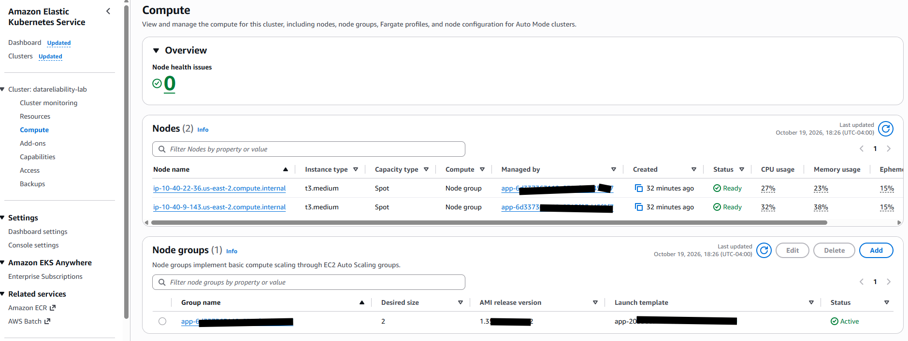

Two `t3.medium` **Spot** nodes from one managed node group, placed in two Availability Zones (the
`10.40.9.x` and `10.40.22.x` addresses are in different AZs' subnets). Spot keeps an ephemeral lab cheap.
The API's topology spread put one replica on each.

<details>
<summary><b>More AWS screenshots: add-ons, VPC</b></summary>

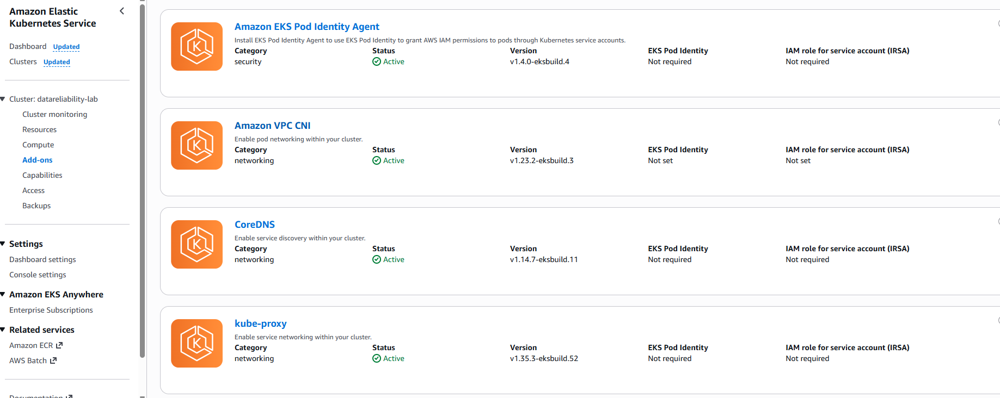

Managed add-ons. The **EKS Pod Identity Agent** is what lets a pod assume an IAM role without static
access keys or the older IRSA/OIDC setup.

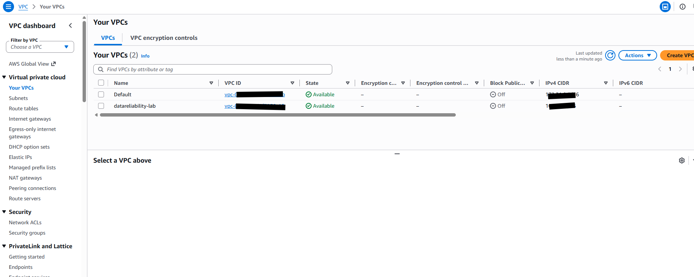

The lab's own VPC next to the account's default VPC. Inside it: public, private and database subnets
across two AZs, and one NAT gateway, a deliberate cost trade-off recorded in
[ADR 003](docs/adr/003-single-nat-gateway.md).

</details>

## SLOs

| SLI | SLO (30 d) | Alerting |
|---|---|---|
| Availability (non-5xx) | 99.9% | Multi-window burn rate: 14.4× (1h & 5m) page, 6× (6h & 30m) ticket |
| Latency (< 300 ms) | 95% | 6× page, 3× ticket, plus per-route p95 ticket |
| Client-side availability | informational | `SyntheticClientFailing`, black-box, catches outages where the API exports nothing |
| RTO / RPO | 15 min / 5 min | DR drill; backup freshness page at 7 min |

Rationale, burn-rate maths and why there are two availability SLIs: [docs/slos.md](docs/slos.md).

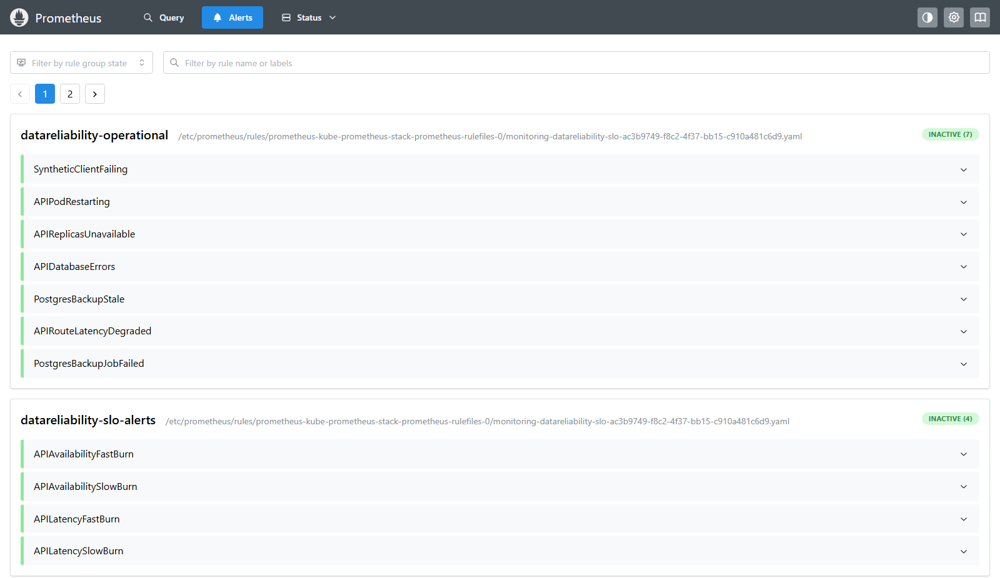

The project's **11 alert rules** in Prometheus. `datareliability-slo-alerts` holds the four burn-rate
alerts that decide paging. `datareliability-operational` holds the symptom alerts. Several of those
exist because a scenario proved they were missing: `APIRouteLatencyDegraded` (scenario 02), the
rewritten `PostgresBackupJobFailed` and the 7-minute `PostgresBackupStale` (scenario 03). *Inactive*
means healthy right now. Every rule links to a runbook in [docs/runbooks/](docs/runbooks/).

## Security and audit evidence

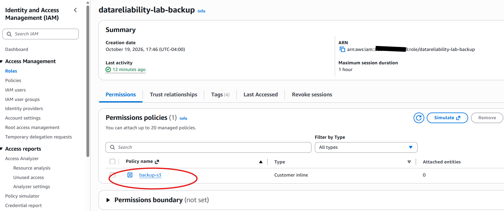

The backup job's IAM role has exactly one inline policy, `backup-s3`: list the bucket, plus get and
put under `postgres/*`. **No delete.** This was proven, not assumed: a pod using that role got
`AccessDenied` on `DeleteObject` and on writes outside `postgres/`
([evidence](evidence/aws/iam-least-privilege-check.txt)). A compromised backup job cannot erase
backup history.

<details>
<summary><b>More: ECR, Secrets Manager rotation, CloudWatch audit logs</b></summary>

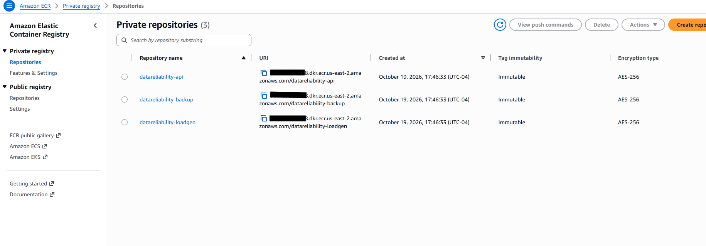

ECR repositories with **immutable tags**: a tag can never be overwritten, so `helm rollback` to
`1.0.1` always means the exact image that was tested. (Locally this lab once rebuilt an image under
the same tag by mistake; that's the failure this setting prevents.) Images are scanned on push.

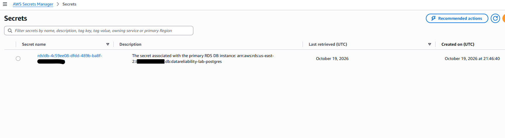


The RDS master password exists **only** in Secrets Manager, created and rotated by RDS
(`manage_master_user_password`), never in Terraform state or Git. It rotates **every 7 days**, which
means this deployment, which copies the password into a Kubernetes Secret once, would break on
schedule. That's scenario 03 for real. The fix is to read the secret at connect time
([DR Drill 002, finding 6](docs/dr/dr-drill-002-rds-pitr-results.md)).

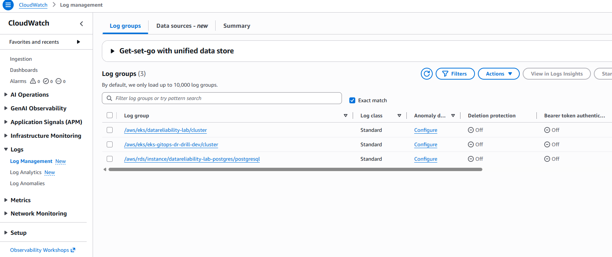
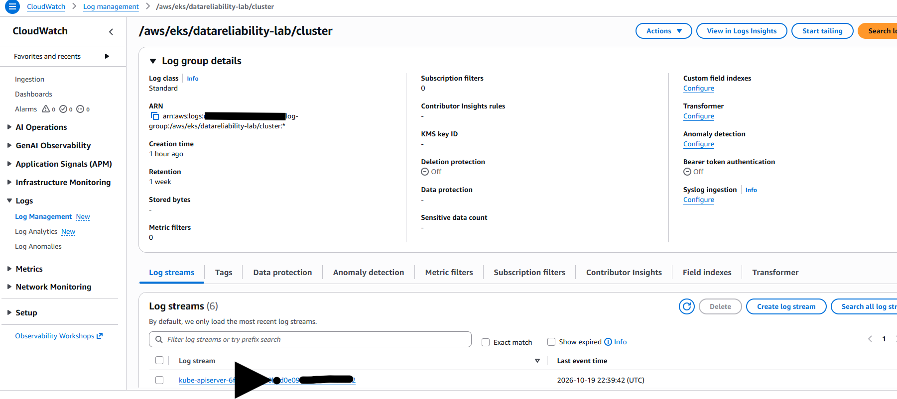

EKS control-plane logs (API, audit, authenticator) and RDS PostgreSQL logs in CloudWatch with 1-week
retention: the "who changed what, when" trail an incident review or a SOC 2 change-management audit
asks for. (The `eks-gitops-dr-drill-dev` group is a leftover from an earlier project.)

</details>

## Run it

Requirements: Docker (8 GB+ RAM for the VM), `kind`, `kubectl`, `helm`, Python 3.11+, AWS CLI (used
against the local S3 store). Cross-platform; developed on Windows 11.

```bash
python lab.py up                  # cluster, object store, monitoring, Postgres, API, backups, traffic (~8 min)
python lab.py seed 1000000        # 1M synthetic customers (makes scenario 02 meaningful)
python lab.py scenario 04 run     # inject → detect → diagnose → remediate → verify, writes evidence/
python lab.py dr-drill            # destroy the database volume, restore, measure RTO/RPO
python lab.py verify-backup       # restore newest backup into a scratch DB and check it
python lab.py down                # delete everything (add --keep-backups to keep the object store volume)
```

AWS (billable, about $0.21/hour; see [Cost](#cost)):

```bash
cp terraform/terraform.tfvars.example terraform/terraform.tfvars   # set admin_cidrs, budget options
terraform -chdir=terraform init -backend-config="bucket=<state-bucket>" -backend-config="region=us-east-2"
terraform -chdir=terraform apply
python lab_aws.py deploy && python lab_aws.py seed 1000000
python lab_aws.py pitr-drill      # DR Drill 002
python lab_aws.py cleanup-restored && terraform -chdir=terraform destroy   # restored instance is outside TF state
```

| | URL |
|---|---|
| API docs | http://127.0.0.1:30080/docs |
| Grafana: *DataReliability — SLO Overview* | http://127.0.0.1:30300 (anonymous view) |
| Prometheus alerts | http://127.0.0.1:30090/alerts |

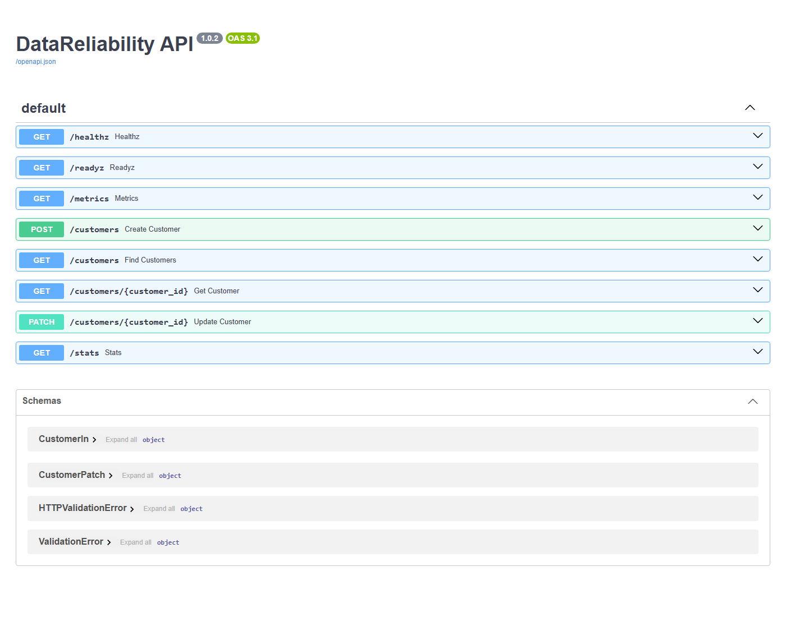

The API under test, from its auto-generated docs at `/docs`. Two endpoints matter most for
reliability:
- **`/healthz`** (liveness) deliberately does **not** touch the database, so a database outage never
  turns into a restart storm.
- **`/readyz`** (readiness) does check the database, so a pod that can't serve is pulled from the
  Service.

`/stats` reports the newest record, which is how the DR drills measure data loss. The version badge
(1.0.2) is the build carrying the fixes from scenarios 04 and 05.

## Repository map

```
app/                       FastAPI service + integration tests (real PostgreSQL)
loadgen/                   synthetic traffic and client-side SLI
backup/                    validated pg_dump -> S3, restore with archive validation
charts/datareliability-api/            Helm chart: probes, spread, PDB, preStop, ServiceMonitor
charts/datareliability-observability/  SLO recording rules, burn-rate alerts, Grafana dashboard
k8s/                       kind config, PostgreSQL, backup CronJob, loadgen
terraform/                 AWS: VPC, EKS, RDS, S3, ECR, Pod Identity, Budget, GuardDuty
lab.py                     lab driver: up/down, scenarios, DR drill, evidence recorder
lab_aws.py                 AWS driver: ECR push, deploy to EKS, PITR drill, cleanup
scripts/                   PromQL helpers for incident numbers
evidence/                  raw JSON timelines from every run
docs/                      architecture, SLOs, scenarios, runbooks, incidents, DR, ADRs, security
.github/workflows/ci.yml   tests, Helm lint, Terraform validate + Checkov, Trivy (actions pinned by SHA)
```

## Documentation

- **Runbooks** (linked from every alert): [availability](docs/runbooks/api-availability.md) ·
  [latency](docs/runbooks/api-latency.md) · [crash loop](docs/runbooks/pod-crashloop.md) ·
  [database connectivity](docs/runbooks/database-connectivity.md) · [node failure](docs/runbooks/node-failure.md) ·
  [disaster recovery](docs/runbooks/disaster-recovery.md)
- **Post-incident reviews:** [docs/incidents/](docs/incidents/) ([template](docs/incidents/TEMPLATE.md))
- **Hypotheses written before running:** [docs/scenarios.md](docs/scenarios.md)
- **AWS deployment, all screenshots with captions:** [docs/aws-deployment.md](docs/aws-deployment.md)
- **Decisions:** [ADR 001 local-first](docs/adr/001-local-first.md) ·
  [ADR 002 dumps vs PITR](docs/adr/002-logical-backups-and-pitr.md) ·
  [ADR 003 single NAT](docs/adr/003-single-nat-gateway.md)
- **Security:** [controls and evidence](docs/security/controls.md) · [IaC scan + accepted exceptions](docs/security/iac-scan.md)

## Cost

Milestone 1 runs entirely on a laptop: **$0**. The AWS stack is built to live for hours, not months:
one NAT gateway, Spot nodes, `db.t4g.micro`, no deletion protection, `force_destroy` on buckets and
registries.

**Milestone 2 session, 2026-10-19:** `terraform apply` 21:46 UTC → `terraform destroy` complete
23:14 UTC (**1 h 28 min**). Estimated at **≈ $0.60–0.90**: EKS $0.10/h, NAT ≈ $0.05/h plus image-pull
data, 2 Spot nodes ≈ $0.03/h, RDS ≈ $0.02/h (two instances for ~50 min during the drill), CloudWatch
ingestion. *This is an estimate. Cost Explorer lags by about a day.*

Teardown verification (us-east-2, after destroy): no EKS clusters, EC2 instances, volumes, ENIs, NAT
gateways, Elastic IPs, load balancers, RDS instances, snapshots or automated backups, ECR repositories
or secrets; only the default VPC remains. Two things `destroy` does not cover were handled by hand: the
drill's restored RDS instance (outside Terraform state; `lab_aws.py cleanup-restored`) and the RDS
PostgreSQL log group (created by RDS, not Terraform). Kept on purpose: the Terraform state bucket.
The EKS KMS key is in its mandatory deletion waiting period.

## Roadmap

- [x] **Milestone 1:** local lab, SLOs, 5 scenarios, DR drill, reports, fixes re-verified
- [x] **Milestone 2:** AWS apply → DR Drill 002 (RDS PITR after a bad DELETE) → least-privilege check → destroy, teardown verified
- [ ] Multi-AZ failover drill (skipped in the first AWS session to keep it short)
- [ ] **Milestone 3:** GitOps delivery with post-deploy SLO gate and auto-rollback; WAL archiving;
      memory-headroom alert; auth-failure alert; human-run (unscripted) DR drill
