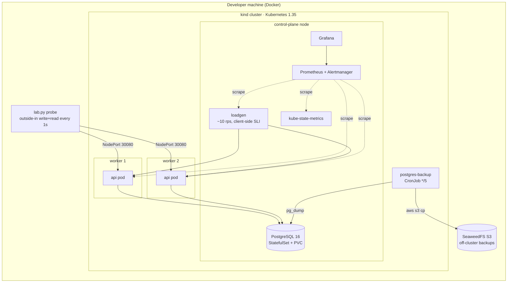
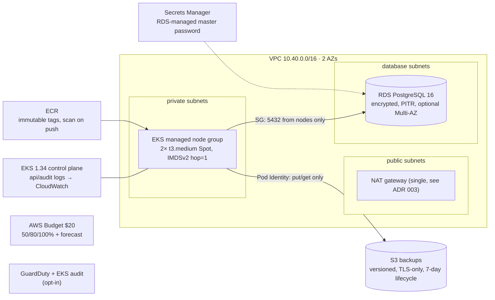

# Architecture

> This is a simplified lab architecture for a fictional data-management SaaS. It is **not** a
> diagram of Semarchy's internal SaaS deployment. It borrows only the publicly documented shape
> of Semarchy's self-hosted platform: Kubernetes services in front of PostgreSQL (RDS on AWS),
> with object storage, monitoring and staged dependencies.

## Local lab (Milestone 1, $0)

### Placement decisions

| Component | Where | Why |
|---|---|---|
| API replicas | Workers, spread by `topologySpreadConstraints` | One node failure leaves one replica serving |
| PostgreSQL, loadgen, Prometheus, Grafana | Control-plane node | Worker-failure drills test the app tier without also blinding the monitoring or killing the single DB instance |
| Backups | SeaweedFS **outside** the cluster | A backup inside the blast radius is not a backup. Survives PVC loss and `kind delete cluster` |

### Health model

| Endpoint | Probe | Touches DB? | Why |
|---|---|---|---|
| `/healthz` | liveness, startup | No | A DB outage must not trigger a restart storm; restarting cannot fix the DB |
| `/readyz` | readiness | Yes | Pull a pod out of the Service when it cannot serve real requests |

Readiness does **not** prove correctness. A release with broken SQL passes it (scenario 04).
That is why CI runs integration tests against a real PostgreSQL.

## AWS (Milestone 2, ephemeral)

| Local | AWS | What changes |
|---|---|---|
| kind | EKS | Managed control plane, real AZs |
| PostgreSQL StatefulSet | RDS PostgreSQL 16 | PITR replaces 5-minute dumps as the primary RPO mechanism |
| SeaweedFS | S3 | Same `aws s3` commands in `backup.sh`; only the endpoint changes |
| Kubernetes Secret created by `lab.py` | Secrets Manager (RDS-managed) | Rotation is owned by AWS |
| `kind load docker-image` | ECR | Immutable tags make `helm rollback` trustworthy |
