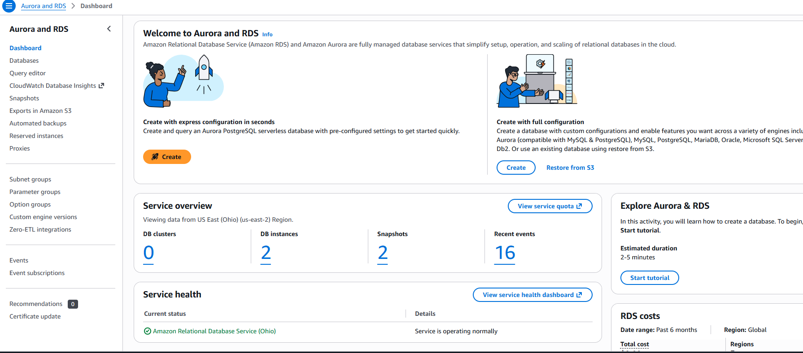
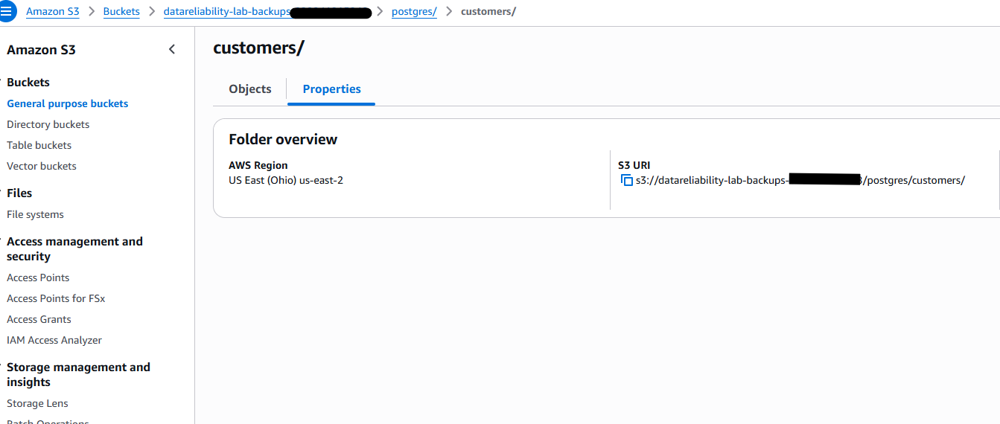
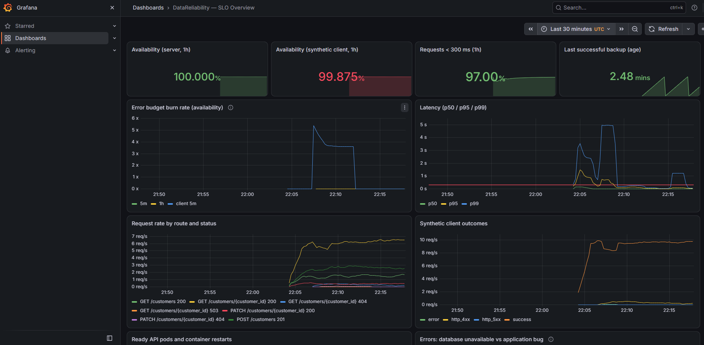
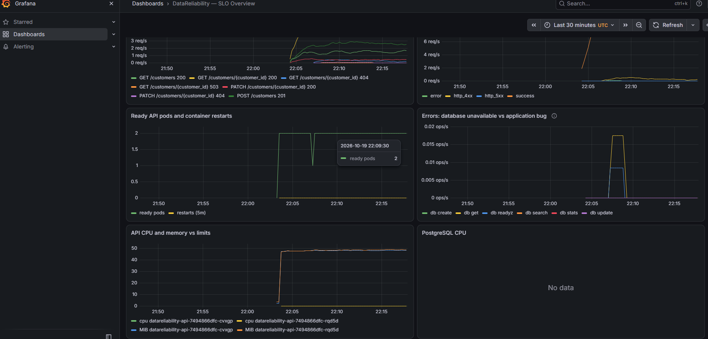

# AWS deployment (Milestone 2): what was built and what it proves

Deployed 2026-10-19 to **us-east-2** from [`terraform/`](../terraform/) (80 resources, 11 min apply) and
[`lab_aws.py`](../lab_aws.py), used for [DR Drill 002](dr/dr-drill-002-rds-pitr-results.md), then destroyed.
Account identifiers are redacted in the screenshots.

## Platform

**EKS 1.35, inside Semarchy's documented 1.32–1.35 range, matching the local lab.** 22 pods, 1 Pod Identity association.

**Two Spot nodes (t3.medium) from one managed node group**, in two AZs. Spot keeps an ephemeral lab cheap; an
interruption would have been useful failure data.

**Managed add-ons, including the Pod Identity Agent**, which lets the backup job use an IAM role with no keys in the cluster.

**A dedicated VPC** next to the account's default VPC: public, private and database subnets across 2 AZs, one NAT gateway ([ADR 003](adr/003-single-nat-gateway.md)).

## Data and recovery

**After DR Drill 002: the original instance, kept unmodified for investigation, beside the point-in-time
restored instance now serving the application.**

**Logical backups to S3 every 5 minutes, written through Pod Identity.** The size column is where the
silent data loss showed up (−16.7% after the DELETE). See [DR Drill 002, finding 5](dr/dr-drill-002-rds-pitr-results.md).

## Security

**The backup role has one inline policy (`backup-s3`): list, plus get/put under `postgres/*`. No delete.**
Verified with a denied request, not just by reading the policy:
[`evidence/aws/iam-least-privilege-check.txt`](../evidence/aws/iam-least-privilege-check.txt).

**ECR: immutable tags** (a tag always means the same image, which makes rollbacks trustworthy) and encryption at rest.

**The RDS master password lives only in Secrets Manager**, managed by RDS, never in Terraform state or Git,
**with automatic 7-day rotation.** That rotation would break this deployment's copied Kubernetes Secret.
See [DR Drill 002, finding 6](dr/dr-drill-002-rds-pitr-results.md).

## Audit and observability

**EKS control-plane logs (API, audit, authenticator) and RDS PostgreSQL logs in CloudWatch**, with 1-week retention.

**The same SLO dashboard as the local lab, running on EKS during the drill.** Server-side availability stayed
at **100%** while a sixth of the customers were missing. The red synthetic-client figure (99.86%) is mostly the
planned 13-second write freeze during cutover. (*PostgreSQL CPU: no data* is expected: on AWS the database is
RDS, not a pod, so its CPU is in CloudWatch.)

