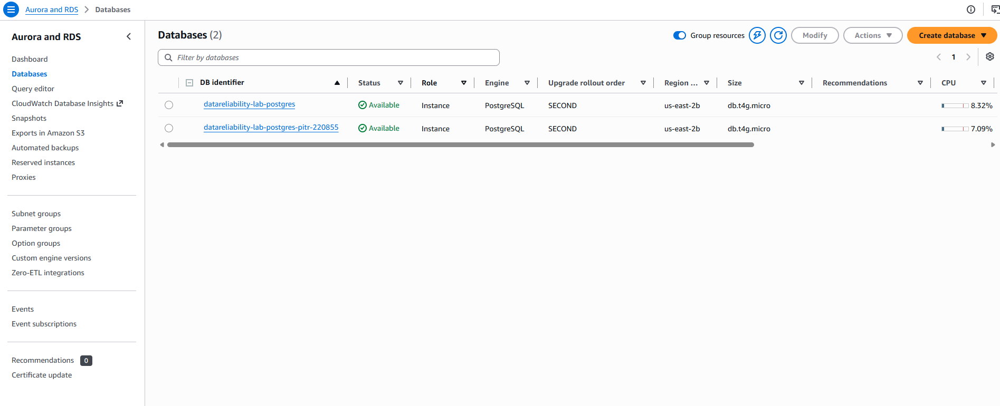
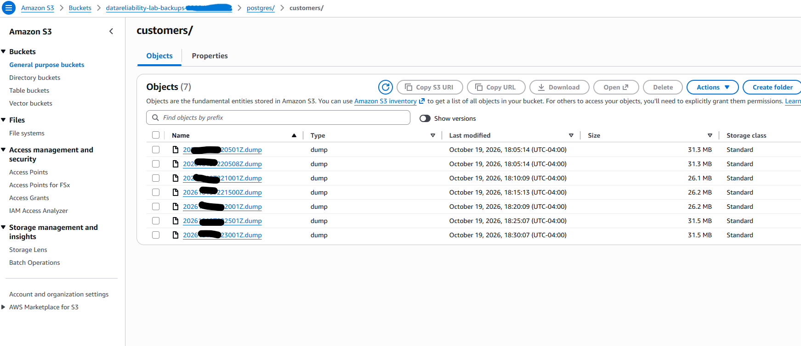
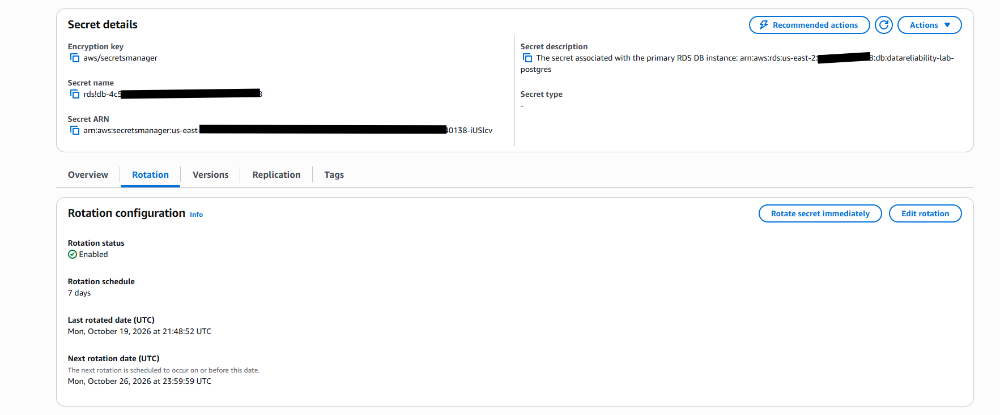

# DR Drill 002: Accidental mass DELETE, recovered with RDS point-in-time restore

**Date:** 2026-10-19 · **Environment:** AWS us-east-2. EKS 1.35 (2 Spot nodes, 2 AZs), RDS PostgreSQL 16
(`db.t4g.micro`, Single-AZ, 3-day automated backups). Built from [`terraform/`](../../terraform/), driven by
[`lab_aws.py pitr-drill`](../../lab_aws.py).
**Targets, set before the drill:** RTO 60 min (PITR always builds a *new* instance) · **zero loss of data
that existed before the bad change**

| | Target | Measured | Result |
|---|---|---|---|
| **RTO** (bad change committed → 10 consecutive successful write+read cycles on correct data) | 60 min | **15 min 52 s** | ✅ MET |
| Pre-incident data recovered | 100% | **100%**: all 166,722 GB customers back, 0 duplicate IDs | ✅ |
| Good writes made *after* the restore point | — | **2,372 inserts reconciled**; **101 updates lost** | ⚠️ partial |
| Customer-facing errors | — | 11 failed probe cycles: 6 during the planned 13 s write freeze | |
| **Did any availability/latency SLO alert on the data loss?** | — | **No** | ⚠️ the finding |

Evidence: [`evidence/dr-drill-002-pitr-20261019T220629Z.json`](../../evidence/dr-drill-002-pitr-20261019T220629Z.json)

## Why this scenario

DR Drill 001 was infrastructure loss: the database disappears and everything fails loudly. The more common
real-world data disaster is quieter: **a valid, committed statement destroys data on a perfectly healthy
database.** No pod restarts, no 5xx, nothing for an SLO to see. Point-in-time recovery exists for this case.

## Timeline (UTC)

| Time | Offset | Event |
|---|---|---|
| 22:06:29 | T−9 s | Steady state: 1,000,381 customers, 166,720 in GB |
| **22:06:38.041** | **T+0** | **`DELETE FROM customers WHERE country = 'GB'` commits: 166,721 rows** |
| 22:07:08 | T+30 s | Checked: **no alerts firing.** Service up, data wrong |
| 22:07:08 | T+30 s | Decision: PITR to **22:06:37.041** (1 s before the commit) |
| 22:08:55 | T+2 m 18 s | `LatestRestorableTime` passes the target (waited **108 s**) |
| 22:09:01 | T+2 m 23 s | `restore-db-instance-to-point-in-time` → new instance `…-pitr-220855` |
| 22:09:49–22:10:12 | | `APIRouteLatencyDegraded` fires and resolves: I/O from the 166k-row delete on a micro instance |
| 22:21:17 | T+14 m 39 s | Restored instance **available** (build time **12 min 15 s**) |
| 22:21:20 | T+14 m 42 s | Verified on the new instance: 1,000,393 rows, 166,722 GB, max id 1,000,393 |
| 22:21:20 | | Cutover 1: **stop writes** (API and load generator to 0) |
| 22:21:33 | | Measured on the old instance since the restore point: **2,372 inserts**, **101 updates to older rows** |
| 22:21:36 | | Cutover 2: the 2,372 inserts copied into the restored instance (`\copy`), sequence realigned |
| 22:21:36 | | Cutover 3: API (Helm) and backup job repointed to the new endpoint |
| **22:22:30** | **T+15 m 52 s** | **Recovered** |

Where the 15 m 52 s went: decision 30 s (scripted) · waiting for restorability 108 s · **RDS building the
instance 735 s (77%)** · verify + cutover 73 s.

## Findings

**1. Nothing on the SLO dashboard noticed a sixth of the customers disappearing.** Availability stayed at
100%. Reads of deleted customers return `404`, which is a client error by definition and correctly excluded
from the availability SLI. The only alert in the whole window was a latency ticket caused by the delete's I/O,
not by the loss itself. **Service SLOs measure whether the service answers, not whether the data is right.**
Detection here was "scripted human noticed". In reality it would be a customer, hours later. This drill
measures recovery time, not detection time.

**2. PITR replays by commit time, not by statement start.** The restored instance had *one more* GB customer
(166,722) than the DELETE removed (166,721). Deleting 166k rows took about a second. A customer inserted after
the DELETE began was invisible to it, and was committed before the restore point. Restoring to 1 s before the
**commit** was correct. Anchoring on when the statement *started* would have been the wrong mental model.

**3. You cannot restore to "now".** `LatestRestorableTime` lags real time (RDS ships transaction logs about
every 5 minutes). The drill waited **108 s** before the restore point was even reachable. That time is part of
RTO, and it is irreducible.

**4. PITR loses good writes too, unless you reconcile them.** Everything after the restore point is gone on
the new instance, including legitimate work done while the incident was being handled:

| Writes after the restore point | Count | Handled |
|---|---|---|
| New customers | 2,372 | ✅ Copied from the old instance by id range during the write freeze |
| Changes to existing customers (`PATCH`) | 101 | ❌ **Lost.** Not reconciled in this drill |

Reconciling inserts was easy because ids are monotonic. Updates need a decision for every row: does the old
instance's value win, or was that row touched by the bad change? That is a judgment call, not a script.
**The 15-minute restore is a 15-minute window of writes that must be reconciled or lost.**

**5. The backups recorded the damage, and nothing looked at them.** Found while reviewing the S3
screenshots, not by any alert:

| Backup (UTC) | Size | |
|---|---|---|
| 22:05:08 | 32,868,700 B | before the DELETE |
| **22:10:01** | **27,390,633 B** | **−16.7%**, the first backup after the DELETE |
| 22:15:00, 22:20:01 | 27.4–27.5 MB | still missing the GB customers |
| 22:25:01 | 33,021,426 B | after cutover to the restored instance |

Two consequences:
- **A free detector was ignored.** A dump that shrinks by a sixth in five minutes, with no
  retention job running, is a strong data-loss signal. An alert on "backup size fell > 10% vs the
  previous one" would have fired 3.5 minutes after the DELETE, which beats any customer report.
- **"Newest valid backup" would have restored the corrupted data.** The three dumps after the
  DELETE are perfectly valid archives (they would pass `verify-backup`) that contain the wrong data.
  Validity is not correctness. Choosing a restore point for logical corruption means choosing a time
  *before* the incident, which is what PITR's timestamp does and "latest" does not.

**6. The managed password rotates every 7 days, and this deployment would break on schedule.**
`manage_master_user_password` gives RDS a Secrets Manager secret with **7-day automatic rotation**
(next rotation 2026-10-26). `lab_aws.py deploy` copies the password into a Kubernetes Secret once.
Left running, the API would fail to reconnect after the first rotation plus a connection drop: scenario
03 (credential drift), but happening for real. The fix is the one that report calls for. The pod must
read the secret at connect time (External Secrets Operator / Secrets Store CSI driver, or IAM database
authentication, which this instance already has enabled).

**7. The write freeze was what made reconciliation safe.** Copying post-restore-point rows while the API was
still writing to the old instance would have raced. The freeze cost 6 failed probe cycles (13 s).

## Verified, not assumed

- Restored data checked on the **new** instance before cutover (row counts, GB count, max id).
- After cutover: `count(*) - count(DISTINCT id) = 0`, the same for `external_id`, and the sequence's `last_value`
  equals `max(id)`, so no collisions on the next insert.
- The toolbox, API and backup job all point at the new endpoint. The old instance was kept, unmodified, for
  investigation, which is standard practice and why PITR creates a new instance rather than rewinding the old.

## Also verified on AWS in this session

| Control | Evidence |
|---|---|
| Backup job writes to S3 through **EKS Pod Identity** (no static keys) | 32.9 MB dump in 12 s |
| Backup role **cannot delete** backups or write outside `postgres/` | `AccessDenied` on `DeleteObject` and `PutObject evil.txt`: [`evidence/aws/iam-least-privilege-check.txt`](../../evidence/aws/iam-least-privilege-check.txt) |
| RDS master password managed by Secrets Manager, never in Terraform state | `manage_master_user_password = true` |

## Action items

| Action | Why | Status |
|---|---|---|
| Data-integrity signals: alarm on a sudden drop in `count(*)` per tenant/country, and on a spike in `404`s for reads by id | Finding 1: SLOs were blind | Open |
| Alert when a backup is > 10% smaller than the previous one | Finding 5: would have detected the DELETE in about 3.5 min | Open |
| Deliver the DB credential at connect time (External Secrets / CSI driver, or IAM DB auth) | Finding 6: 7-day rotation would break the copied Secret | Open |
| Guardrail on destructive SQL: no unscoped `DELETE`/`UPDATE` from humans; `statement_timeout` + approval for bulk changes | Prevention beats PITR | Open |
| Update reconciliation procedure (export changed rows from old instance, review, apply) | Finding 4: 101 updates lost | Open |
| Logical replication / CDC to make post-restore-point reconciliation systematic | Shrinks the reconcile-or-lose window | Open |
| The drill-created instance is outside Terraform state: in production, `terraform import` it (or rebuild from it) so IaC matches reality | `terraform destroy` would not remove it; `lab_aws.py cleanup-restored` must run first | Open (lab: handled at teardown) |
